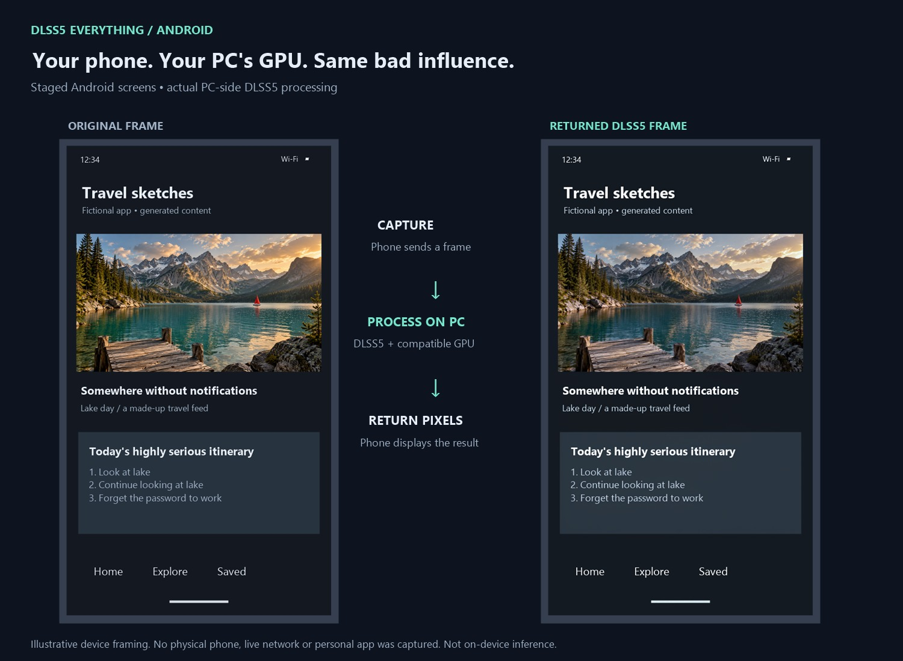
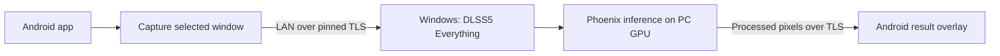

# DLSS5! For your phone.

**Not really. Your PC does the heavy lifting. Your phone takes the credit.**

I tried putting the whole thing on a phone. [It works. Slowly. Spectacularly slowly.](https://github.com/RazvanManolache/dlss5-android-test)
That experiment's faster GPU mode still needed about **860 ms per model call** on
the tested Adreno 735. A slideshow with excellent ambition.

So this companion takes a less heroic route: send an app's picture to your PC,
let **DLSS5 Phoenix** process it, and put the result back over the app. Same pocket.
Much bigger GPU. A very elaborate way to make your phone look busy.

*Fictional app screen, actual PC-side Phoenix output. The phone frames are staged;
this is not a phone screenshot or a live-streaming benchmark. [Image provenance](docs/demo-image.md).*

- **Enhance one app**, or follow the active app with optional Accessibility access.
- **Live knobs:** iterations, tone, structure, skin and automatic masking. Apply
  your choices from the floating panel. Subtlety is available, not compulsory.
- **Original / result toggle**, capture-size and FPS limits, touch-through or
  view-only display, and Stop buttons where you can actually find them.
- **Raw or Pyrowave transport.** Spend bandwidth recklessly, or ask the phone's
  Vulkan GPU to help compress it. Pick your particular inconvenience.
- **Private-LAN pairing:** pinned TLS, a rotating token, encrypted saved credentials.
  No account, cloud relay, analytics or recording feature.

**[Download the Android ARM64 preview](https://github.com/RazvanManolache/dlss5-everything-android-companion/releases)**
· **[Get the Windows host](https://github.com/RazvanManolache/DLSS5-Everything/releases)**
· **[Setup and limitations](android/README.md)**

> The app appears as **Phoenix Link** on Android. This is an independent project,
> not an official NVIDIA app or Android DLSS SDK. The companion adds a processed
> overlay; it does not add engine integration, DLSS Super Resolution or Frame
> Generation to your Android games. It is a preview, not a promise of free FPS.

## How this particular crime against restraint works

The neural model runs on the **PC**. The phone handles capture, optional Vulkan
encoding/decoding and presentation. Your game still runs on your phone; input
isn't forwarded to the PC. No model, NVIDIA DLL or Phoenix inference library is
inside this APK.

This is a roundtrip, so capture, conversion, compression, Wi-Fi, inference and
display all cost time. It cannot make your game render faster. The latest unsent
capture replaces older captures instead of building a queue of increasingly
historical greatness.

## Get it running

1. Install the **ARM64 APK** on an **Android 14+** device. Allow installation from
   the source you use to open it. This is a signed GitHub preview, not a Play Store app.
2. On a compatible Windows PC, open **DLSS5 Everything → Streamer**. Configure its
   Phoenix components and a compatible, separately obtained model, choose your
   private IPv4 address and press **Start streamer**.
3. Enter the PC's address, port, certificate fingerprint and token in the phone's
   connection fields. **Export pairing** on the PC can save those details for
   reference; this Android UI currently uses manual entry, not file import. Keep
   them private; pairing credentials change when the server restarts.
4. Choose **Single app** or **Follow active app**, grant only the permissions for
   that mode, then **Start session**. In Android's sharing picker choose **one app**.
5. Open the floating controls, tune, **Apply settings**, and compare. **Stop** ends
   the session. Permission alone does not start streaming.

Use a trusted private network. Firewall access should be limited to that network
and phone. There is no Internet relay, remote pairing service or automatic discovery.

## The small print has entered the chat

- **No whole-display enhancement.** Capturing our own overlay produces the sort
  of feedback loop normally reserved for bad meetings. Secure/DRM content stays protected.
- **Touch-through has a catch:** Single app blends the result with the original
  at Android's allowed opacity, normally at most 80%. View only can be opaque but
  intercepts touches. Follow mode can use an opaque accessibility overlay while
  leaving app touches unchanged; it pauses on protected/system windows.
- **Pyrowave needs a compatible Vulkan driver at both ends.** Unsupported devices
  get an error; select Raw yourself. Raw 720p at 15 FPS is roughly **442 Mbit/s
  each direction**, before overhead. Your router is allowed to have opinions.
- **Latency, heat and battery use are real.** Default capture is capped at 15 FPS;
  this is a sampling limit, not measured delivered FPS. No smoothness guarantee.
- No audio, camera capture, recording, input forwarding or unattended reconnect.
  App switching, rotation, vendor permission behavior and long sessions still
  need broader hardware testing. Contributions and unusually patient testers welcome.

## Build, tests and receipts

- [Build instructions](docs/BUILD.md), including SDK links, pinned dependencies,
  unit tests and release signing. Building the APK does **not** need the Windows repo.
- [Client details](android/README.md): permissions, capture modes, transport and stopping.
- [Historical runtime checks](docs/android-emulator-validation.md): emulator,
  phone codec and real-PC processing evidence, with their boundaries.
- [This release's checks](docs/releases/v0.3.0-preview.1.md): what was rerun and what wasn't.
- [MIT project license](LICENSE) and [third-party notices](THIRD_PARTY_NOTICES.md).

The [on-device museum experiment](https://github.com/RazvanManolache/dlss5-android-test)
is a different project. This one outsources the existential crisis.

## Build on GitHub

Open [Actions](https://github.com/RazvanManolache/dlss5-everything-android-companion/actions), select **Android**, then choose **Run workflow** and a branch. When the run succeeds, download its files from **Artifacts** at the bottom of the run page (GitHub sign-in required).

phoenix-companion-arm64-development-apk is an installable debug build for ARM64 devices. phoenix-companion-arm64-release-unsigned needs your own release signing before installation. Development APKs cannot update a release-signed installation in place.

Build downloads are retained for 14 days. They are development snapshots, separate from tagged releases; running this workflow does not publish a release.
